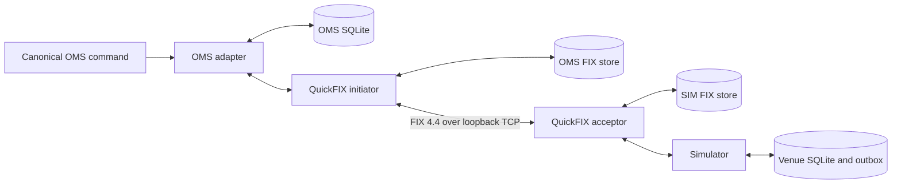

# Design and interfaces

## Deployment and session ownership

One batch process owns a QuickFIX initiator (OMS), a QuickFIX acceptor (SIM), two SQLite journals and an exclusive state-directory lock. The listener binds to an ephemeral IPv4 loopback port. After verifying the accepted peer against the client socket it closes the listener. The compiled transport exposes no remote host setting. The simulator uses a fixed USD 100.00 quote for one synthetic equity. A buy at or above that quote or a sell at or below it fills in full at the quote. Other eligible orders rest until replaced or canceled.



The event loop drives QuickFIX session timers, drains framed messages with the library's parser, and publishes the venue outbox. The process maintains the connection for the duration of a batch. QuickFIX owns logon, sequence verification, liveness, CompID checks, resend selection, PossDupFlag, OrigSendingTime, administrative gap-fill and bilateral logout. CompIDs identify these local roles. The application supplies no credentials. The heartbeat interval is 30 seconds.

## Version 1 contract

The CLI accepts one command, or `run FILE` for a whitespace-separated UTF-8 batch. Blank lines and lines starting with `#` are ignored. A malformed command halts the batch. Earlier accepted commands remain durable.

```text
new     ID      SYNTH buy|sell SHARES LIMIT_CENTS
replace ID ORIG SYNTH buy|sell SHARES LIMIT_CENTS
cancel  ID ORIG SYNTH buy|sell SHARES
reconnect
status
```

IDs are 1–40 ASCII letters, digits, underscores or hyphens. Each mutation needs a unique ClOrdID. OrigClOrdID identifies the latest accepted version of the order. The side is immutable. The cancel quantity must match the current order. Quantities are 1–1,000,000 whole shares and prices are 1–100,000,000 cents. New and replace are GTC limit orders. The venue preserves the OrderID across replacements.

- NewOrderSingle (D), OrderCancelReplaceRequest (G) and OrderCancelRequest (F) carry ClOrdID (11), symbol (55), side (54), quantity (38) and UTC transaction time (60). F/G also carry OrigClOrdID (41). D/G require OrdType (40) = 2, Price (44) in decimal USD and TimeInForce (59) = 1. The adapter sends USD in Currency (15). The simulator defaults an omitted currency to USD. Extra application fields on inbound orders are rejected.
- ExecutionReport (8) carries OrderID (37), ExecID (17), ClOrdID, ExecType (150), OrdStatus (39), CumQty (14), LeavesQty (151) and AvgPx (6). The dialect uses 0 for new, 5 for replaced, 4 for canceled and F for trade. A fully filled order has OrdStatus 2. A replace acknowledgment on a working order has OrdStatus 0. Trades carry LastQty (32) and LastPx (31).
- OrderCancelReject (9) carries the request and original IDs, current status, CxlRejResponseTo (434), CxlRejReason (102) and text. An unknown original uses OrderID NONE, OrdStatus 8 and reason 1. A stale or closed chain produces a rejection and preserves the order's latest state.
- The stock FIX44 dictionary validates messages before business handling. Missing required tags produce a session reject (3). A dictionary-valid, unsupported application type produces BusinessMessageReject (j) with reason 3. A corrupted checksum is logged and discarded with the expected inbound sequence unchanged. A subsequent higher sequence triggers recovery.

JSONL records include `schema: 1`. Each `order_result` projects one persisted execution or cancel rejection and includes its first local availability time. Its `kind` is the FIX ExecType or `cancel_reject` / `replace_reject`. Reports use `YYYYMMDD-HH:MM:SS.sss` UTC. A `command_processed` record reports local completion time in microseconds. `status`, `reconnected`, `reconciled` and `logout` contain cumulative journal totals and per-process session counters. A nonzero exit with a `halted` record signals an input, storage, protocol or reconciliation failure. See [sample JSONL](../reports/demo.jsonl).

## Persistence and recovery

The two databases use schema version 1 and independent SQLite transactions with synchronous FULL. Each stores `requests` (ID, canonical terms, original FIX body, completion, creation UTC) and `events` (event ID, request and order IDs, status, fill quantity/price, event and availability UTC, canonical FIX body). The venue's published flag is its transactional outbox. QuickFIX's FileStore separately maintains each direction's sequence numbers and replayable wire messages.

1. The OMS stages the command before calling QuickFIX. The venue checks the command ID and terms, makes its decision and commits reports and outbox entries together. A repeated request reuses the original reports.
2. The venue hands each outbox item to QuickFIX before marking it published. Session recovery replays persisted messages. A crash at that handoff can also republish the same execution from the outbox.
3. The OMS verifies request terms, order transitions, quantities and limit prices. Recording the event and completing the request are atomic. A repeated event ID with the same body leaves the journal unchanged. A conflicting body for the same identity halts processing. Cancel rejections have a synthetic event key derived from ClOrdID because FIX message 9 has no ExecID.
4. On connect, the engine completes the logon and drains replay. The gateway delivers pending outbox entries, resubmits outstanding OMS requests with their original IDs, then compares canonical event bodies and sequence counters in both directions. Only successful reconciliation opens the batch for new commands.

The simulator can reconcile directly against its local venue journal. An external venue would require a separately specified reconciliation interface. Full snapshot comparison costs grow with retained order history.

## Build and provenance

The build pins QuickFIX C++ v1.16.0 and its FIX44 dictionary by archive SHA-256. The bundled XML parser is pugixml. System SQLite stores the application journals. The `nonstop-startup.patch` passes the continuous-session setting into the QuickFIX constructor before its creation-date check. In this release the factory normally applies that setting after construction, which can reset a prior day's file store on restart. A regression test ages the store date before recovering a missing fill. The application also denies destructive store resets. [QuickFIX release](https://github.com/quickfix/quickfix/releases/tag/v1.16.0) · [Local patch](../patches/nonstop-startup.patch) · [QuickFIX license](licenses/QuickFIX.txt) · [pugixml notice](licenses/pugixml.txt)

The CLI, journals, simulator and fixtures were created for this project. No shared OMS contract or licensed market data was supplied. The included commands and constant quote are synthetic. The plan's proposed SAAT ownership, asset class and deployment assumptions require owner confirmation.
