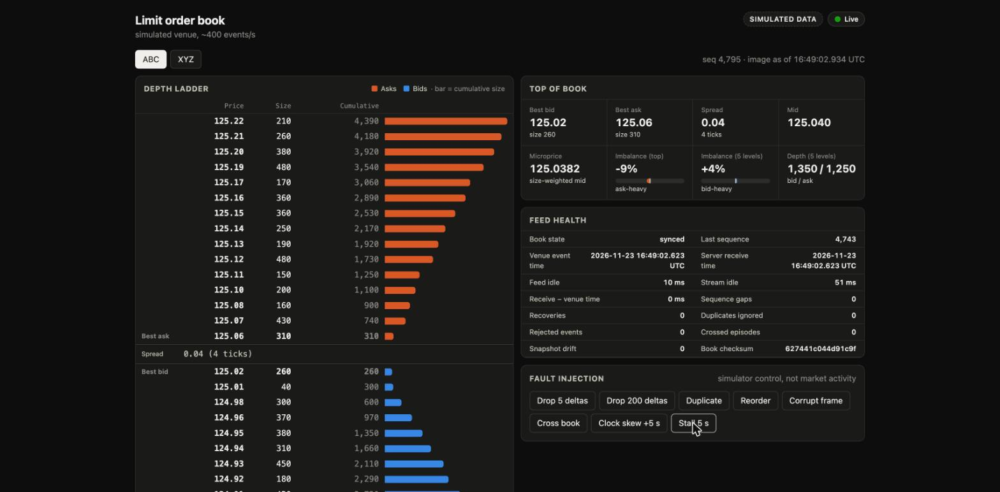
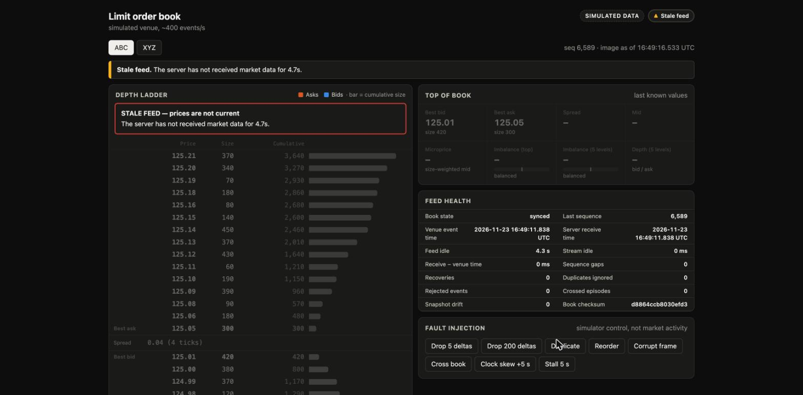

# Real-Time Limit Order Book

> Reconstruct, visualize, and analyze a live or replayed level-2 order book.

**Status:** MVP implemented and tested against a built-in **simulated** venue. No real market data,
broker connectivity or real money is involved anywhere.  
**Stack as built:** Rust (tokio, axum), WebSocket, TypeScript/React (Vite), Prometheus text metrics,
optional ClickHouse sink.



## What it does

Consumes snapshot + incremental level-2 updates, rebuilds the book, detects sequence gaps and
resynchronizes, computes microstructure metrics, and streams the result to a depth UI that makes
feed freshness impossible to miss.

```text
Simulated venue / capture replay            (feed-adapter)
           |  raw frames + local receive time
Parser + schema normalization               (feed-adapter: decimal strings -> integer ticks/lots)
           |
Sequence validator + snapshot/delta reconstructor   (book-core)
           |
In-memory bid / ask depth  ----> metric calculator  (analytics)
           |                          |
           v                          v
   HTTP + WebSocket + /metrics     ClickHouse (optional)   (stream-api)
           |
        Depth UI                                     (ui)
```

## Quick start

Requires Rust 1.99 (pinned in `rust-toolchain.toml`), Node 20+, GNU make.

```bash
make setup             # fetch crates, npm ci
make demo              # build UI, serve on http://127.0.0.1:8080
```

Open the page, then use the **Fault injection** buttons (drop deltas, duplicate, reorder, corrupt a
frame, cross the book, skew the venue clock, stall the feed) and watch the ladder, health panel and
event timeline react. `scripts/failure-demo.sh` does the same from a terminal.

```bash
make lint              # rustfmt, clippy -D warnings, tsc
make test              # unit + scenario + replay suites, UI logic tests
make integration-test  # HTTP/WebSocket/sink tests over real sockets
make replay            # verify the committed capture: checkpoints + output digest
make demo-replay       # UI on a looping replay of that capture
make bench             # compare the two ladder implementations
```

All of these were run for `docs/test-report.md`.

### CLI

```bash
lob serve  [--source sim|replay] [--file capture.ndjson] [--speed 1] [--loop] [--rate 400]
           [--symbols XYZ,ABC] [--stale-after-ms 2000] [--admin]
lob record --out capture.ndjson --events 20000 --seed 42 --faults "drop@2000:3,dup@5000,reorder@8000"
lob replay --file capture.ndjson [--json]      # exit 1 if digest or a checkpoint disagrees
lob bench  [--events 1000000] [--levels 20,200,2000]
```

### API

```text
GET /v1/symbols
GET /v1/books/XYZ/snapshot?depth=20
GET /v1/books/XYZ/quote
GET /v1/books/XYZ/health
WS  /v1/books/XYZ/stream?depth=20&deltas=true
GET /metrics

{"type":"delta","symbol":"XYZ","seq":10204,"side":"BID","price_ticks":10025,
 "quantity":350,"action":"SET","event_ts":1767225600000000}
```

Message types, client rules and the admin routes are in [docs/architecture.md](docs/architecture.md).

## Implemented vs. Planned

### Implemented

| Blueprint item | Where | Tests |
|---|---|---|
| Snapshot + incremental ingestion with schema normalization | [`feed-adapter/src/wire.rs`](src/feed-adapter/src/wire.rs), [`decimal.rs`](src/feed-adapter/src/decimal.rs) | [`tests/unit/wire.rs`](tests/unit/wire.rs) |
| Sequence-gap detection and full resynchronization | [`book-core/src/sequencer.rs`](src/book-core/src/sequencer.rs), [`stream-api/src/engine.rs`](src/stream-api/src/engine.rs) | [`tests/unit/sequencer.rs`](tests/unit/sequencer.rs), [`tests/scenarios/faults.rs`](tests/scenarios/faults.rs) |
| Top-of-book, spread, depth, mid-price, imbalance, microprice, OFI | [`analytics/src/lib.rs`](src/analytics/src/lib.rs) | [`tests/unit/analytics.rs`](tests/unit/analytics.rs) |
| Historical replay at configurable speed (pause, loop, runtime speed change) | [`feed-adapter/src/replay.rs`](src/feed-adapter/src/replay.rs), [`stream-api/src/server.rs`](src/stream-api/src/server.rs), [`offline.rs`](src/stream-api/src/offline.rs) | [`tests/scenarios/replay.rs`](tests/scenarios/replay.rs), [`tests/integration/api.rs`](tests/integration/api.rs) |
| Depth UI with timestamps and stale-feed alerts | [`src/ui/src`](src/ui/src) | [`src/ui/src/logic.test.ts`](src/ui/src/logic.test.ts) |
| Crossed/invalid state always flagged | [`book-core/src/book.rs`](src/book-core/src/book.rs) | [`tests/unit/book.rs`](tests/unit/book.rs), `crossed_book_is_always_flagged` |
| Deterministic simulator with fault injection and ground-truth checkpoints | [`feed-adapter/src/sim.rs`](src/feed-adapter/src/sim.rs) | [`tests/scenarios`](tests/scenarios) |
| WebSocket subscriptions and snapshots, slow-subscriber rebase | [`stream-api/src/server.rs`](src/stream-api/src/server.rs) | [`tests/integration/api.rs`](tests/integration/api.rs) |
| Metrics: feed-to-book latency, gap recovery time, throughput, checkpoint accuracy | [`stream-api/src/metrics.rs`](src/stream-api/src/metrics.rs) | `prometheus_metrics_are_exposed` |
| ClickHouse event/metric storage (optional, non-blocking) | [`stream-api/src/clickhouse.rs`](src/stream-api/src/clickhouse.rs), [`scripts/clickhouse-schema.sql`](scripts/clickhouse-schema.sql) | [`tests/integration/clickhouse.rs`](tests/integration/clickhouse.rs) — stand-in server only |
| Stretch: compare data-structure implementations | [`book-core/src/ladder.rs`](src/book-core/src/ladder.rs), `lob bench` | [`tests/unit/ladders.rs`](tests/unit/ladders.rs) |
| Makefile, CI workflow, replay fixture, ADRs, runbook | [`Makefile`](Makefile), [`.github/workflows/ci.yml`](.github/workflows/ci.yml), [`examples/`](examples/README.md), [`docs/`](docs) | — |

### Written but not verified end to end

* `docker-compose.yml`, `Dockerfile` and the ClickHouse schema: never run against a real ClickHouse
  or built as an image (no Docker daemon on the development machine).
* `.github/workflows/ci.yml`: has not run on GitHub.

### Planned / not built

* A real venue adapter. Only the simulated `simvenue.v1` dialect exists. Connecting a public or
  licensed feed means writing a decoder to the same normalized types **and** checking that venue's
  redistribution terms first.
* Kafka/Redpanda transport — deliberately deferred, see
  [ADR 0002](docs/decisions/0002-in-process-transport.md).
* Level-3 market-by-order simulation; liquidity/OFI heatmap.
* Authentication and authorization. Admin routes are opt-in (`--admin`) and the server binds to
  localhost by default.
* Automated browser tests for the UI; light-mode visual check.

### Explicit non-goals (unchanged)

* Fabricating market-by-order depth from level-1 quotes.
* Unlicensed distribution of proprietary exchange data.
* Claiming end-to-end latency without synchronized clocks.

## Domain model

```text
BookSnapshot(symbol, seq, bids[], asks[], captured_at)
BookDelta(symbol, seq, side, price_ticks, quantity, action, event_ts)
BestQuote(symbol, bid_px, bid_qty, ask_px, ask_qty, asof)
FeedHealth(symbol, state, last_seq, gap_count, stale_ms, stale, integrity, ...)
BookMetric(symbol, ts, seq, spread_ticks, mid_ticks_x2, mid_px, microprice, imbalance, ...)
```

Prices are integer ticks and sizes integer lots end to end. Timestamps are UTC microseconds, with
venue event time (`event_ts`) kept separate from local receive time (`recv_ts`); staleness uses the
local clock only. See [docs/architecture.md](docs/architecture.md#time).

## Definition of done

| Criterion | Status |
|---|---|
| Book never publishes a crossed or invalid state without flagging it | met — tested |
| Dropped or out-of-order deltas trigger a documented recovery path | met — tested, [ADR 0001](docs/decisions/0001-gap-recovery.md) |
| Replay of known events reproduces reference depth at checkpoints | met — 39/39 on the committed capture |
| UI displays feed freshness and does not silently present stale prices | met — see below |



Evidence, measured figures and the list of what was **not** verified:
[docs/test-report.md](docs/test-report.md).

## Repository layout

```text
.
├── Cargo.toml, rust-toolchain.toml, Makefile, Dockerfile, docker-compose.yml
├── src/
│   ├── book-core/      level-2 aggregation and sequence invariants
│   ├── analytics/      spread, depth, imbalance, microprice, OFI
│   ├── feed-adapter/   wire format, simulator, capture/replay
│   ├── stream-api/     engine, HTTP/WebSocket, metrics, sink, `lob` CLI
│   └── ui/             React depth ladder
├── tests/              unit/ · integration/ · scenarios/   (one crate: lob-tests)
├── examples/fixtures/  committed deterministic capture + manifest
├── scripts/            ClickHouse schema, Prometheus config, failure demo
├── docs/               architecture.md, runbook.md, test-report.md, decisions/
└── .github/workflows/ci.yml
```

## Safety, data and operational boundaries

* **Simulated by default and only.** The UI labels every screen "SIMULATED DATA"; the API reports
  `"simulated": true`.
* Use only authorized market feeds; comply with market-data licenses before connecting anything real.
* No secrets in the repository. ClickHouse credentials are read from the environment
  (`CLICKHOUSE_URL`, `CLICKHOUSE_USER`, `CLICKHOUSE_PASSWORD`).
* Integer ticks/lots for all book arithmetic; floating point only in derived analytics.
* Performance figures are measurements from one machine with synthetic load, not capacity claims.
  No strategy or profitability is implied.

## License

Not chosen yet. Pick one (MIT and Apache-2.0 are common) before publishing.
