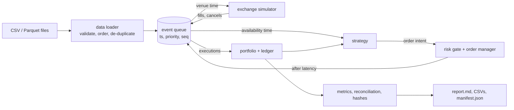

# Architecture

One process, one thread, one totally ordered event queue. Everything that happens in a
backtest is an entry on that queue, so a run is a pure function of its dataset, its
configuration (which includes the strategy's code and parameters) and its seed.

## Flow

| Blueprint service | Module | Responsibility |
|---|---|---|
| data-loader | `data.py`, `fixtures.py` | Read CSV/Parquet, validate rows, put events in canonical order, drop exact duplicates, detect gaps, compute the content hash (`data_version`). |
| clock / event-bus | `eventbus.py` | `SimClock` (never goes back) and `EventQueue`, ordered by `(ts, priority, seq)`. |
| strategy | `strategy.py` | The `Strategy` base class, the `Context` it is handed, and loading a strategy from a file. |
| exchange-sim | `exchange.py`, `fees.py` | Latency, matching against bars or quotes, partial fills, spread, slippage, fees. |
| risk / orders | `risk.py`, `orders.py` | Pre-trade checks with reason codes; the order state machine. |
| portfolio / report | `portfolio.py`, `metrics.py`, `results.py`, `report.py` | Cash, positions, P&L, ledger, reconciliation, metrics, artifacts. |
| orchestration | `engine.py`, `walkforward.py`, `cli.py` | The loop, walk-forward evaluation, the command line. |

## Time

Timestamps are integer nanoseconds since the Unix epoch, UTC. There are no floats and no
time zones anywhere in the engine.

Every market event carries two times:

- `ts_event`: when it became a fact at the venue. For a bar, its close.
- `ts`: when the strategy may know about it. Never earlier than `ts_event`; the loader
  refuses rows where it is.

The engine queues each event twice, once at each time. At `ts_event` the exchange
simulator matches resting orders against it. At `ts` it is appended to the history the
strategy can read and the strategy's `on_market_event` is called. With zero publication
delay the two coincide and the venue entry is processed first.

## Ordering

Entries are processed in order of `(ts, priority, seq)`. `seq` is the order of insertion,
so ties are broken the same way on every run. Priorities at one instant:

| # | Entry | Why it goes here |
|---|---|---|
| 0 | Corporate action | A split must restate positions and cancel orders before anything trades that day. |
| 1 | Market event at the venue | The exchange matches orders that were already resting. |
| 2 | Order or cancel arriving at the exchange | An order that arrives at the instant a bar closes was too late for that bar. |
| 3 | Fill or cancel reaching the portfolio and strategy | The strategy hears about its fill before it sees the bar that caused it. |
| 4 | Market event delivered to the strategy | By now the books reflect everything that happened at this instant. |
| 5 | Timer | A timer sees the complete state of its instant. |

The static part of the queue (market events, corporate actions) is sorted once. Entries
created during the run (order arrivals, executions, timers) go on a heap; the queue pops
whichever is next.

## Why the strategy cannot look ahead

Look-ahead is prevented by construction, then checked.

- The `Context` handed to the strategy has no reference to the dataset. It exposes the
  clock, the portfolio, the strategy's own orders, and a per-symbol history that only
  contains events already delivered.
- A split restates history only once the split has happened (`history(adjusted=True)`),
  so prices before a future split are never pre-adjusted.
- An order can only be filled by market data the exchange sees after the order arrives.
  For bars that means a bar that opens at or after the arrival time (see
  [ADR 0001](decisions/0001-bar-fill-eligibility.md)).
- The engine raises `LookaheadError` if it is ever asked to deliver an event whose
  availability time is ahead of the clock.
- Walk-forward training runs are given a dataset sliced to end before the test window.

`tests/scenarios/test_no_lookahead.py` checks the consequence: deleting or rewriting all
data after a cutoff leaves everything before the cutoff unchanged, including what the
strategy was shown, the orders it sent, the fills and the equity curve.

## Money

Prices, cash, fees and P&L are integers in units of `10^-price_decimals` (default 4).
Quantities are whole units. Rates (basis points, participation, probabilities) are exact
ratios. Every rounding goes against the trader: fees round up, a buyer's price rounds
up, a seller's rounds down. Floats appear only in reported statistics (returns, Sharpe).

The portfolio uses average cost. The identity

    equity = initial cash + realized P&L + unrealized P&L - fees + dividends

holds exactly at every snapshot. At the end of each run the engine re-derives cash and
positions twice, once from the ledger and once from the fill list, and refuses to produce
a result if either disagrees with the portfolio.

## Randomness

Three features draw random numbers: latency jitter, touch fills, and `context.rng` for
strategies. Each has its own stream, derived from the run seed and the stream's name, so
turning one feature on does not change the draws seen by another. Nothing else in the
engine is random, and nothing depends on hash ordering or wall-clock time.

## Reproducibility

| Identifier | Covers |
|---|---|
| `data_version` | The canonical content of the dataset. Independent of file format and row order. |
| `config_hash` | Engine version, fill model version, every configuration field, and the strategy's name, source hash and parameters. |
| run id | `config_hash`, `data_version` and seed. |
| `result_hash` | The canonical text of the orders, fills, ledger and equity curve. |

A run directory holds `report.md`, `metrics.json`, four CSVs, `manifest.json` (the
identifiers above, the full configuration, input paths and a hash of each artifact) and
`runtime.json` (wall-clock timings, the only file that differs between two runs).
`python -m backtester verify <dir>` re-runs from the manifest and compares everything.
The directory is written to a temporary sibling and renamed into place, so a failed write
leaves nothing behind.

## Walk-forward

Folds are aligned to UTC midnight of the first day of data. For each fold:

1. Every parameter combination is run on the training slice, which contains only events
   that became available before the test window starts.
2. The combination with the best training objective is chosen. Ties go to the earliest
   combination; an undefined objective loses.
3. That combination is run once over training plus test data with `trade_from` set to
   the start of the test window. The strategy warms up on the training data, its orders
   are rejected with `WARMUP` until the test window starts, and metrics cover the test
   window alone.

The out-of-sample result chains the test windows' daily returns. Each test window starts
flat with the full initial cash.

## Invariants and where they are tested

| Invariant | Tests |
|---|---|
| Same dataset, config and seed give identical trades and reports | `tests/integration/test_determinism.py` (repeat runs, separate processes with different hash seeds, golden replay), `tests/integration/test_cli.py` (`verify`) |
| No feature reads data later than simulated time | `tests/scenarios/test_no_lookahead.py`, `tests/unit/test_engine.py` (ordering, delayed data, split restatement), `tests/integration/test_walkforward.py` |
| Cash and positions reconcile to fills and fees | `tests/scenarios/test_definition_of_done.py` (16 randomised runs with shorts, partial fills, a split and a dividend), `tests/unit/test_portfolio.py` |
| Reports disclose assumptions, date ranges, gaps and the out-of-sample split | `tests/scenarios/test_definition_of_done.py`, `tests/integration/test_cli.py` |
| A bar never fills an order that arrived after it opened | `tests/unit/test_exchange.py`, `tests/unit/test_engine.py` |
| Costs always round against the trader | `tests/unit/test_exchange.py`, `tests/unit/test_time_and_fixedpoint.py` |
| Bad input fails loudly, bad output leaves nothing behind | `tests/scenarios/test_data_failures.py`, `tests/unit/test_data.py` |

## Limits of the design

- Single-threaded and in-memory. The whole dataset and every equity snapshot are held in
  RAM; see the benchmark in the [runbook](runbook.md) for what that costs.
- The exchange model is top-of-book at best. There is no order book depth, no queue
  position, and the simulated orders have no effect on prices.
- Gap detection is a weekday heuristic. It does not know exchange holidays or sessions.
- Data revisions are refused, not modelled: a bar that appears twice with different
  values stops the load.
