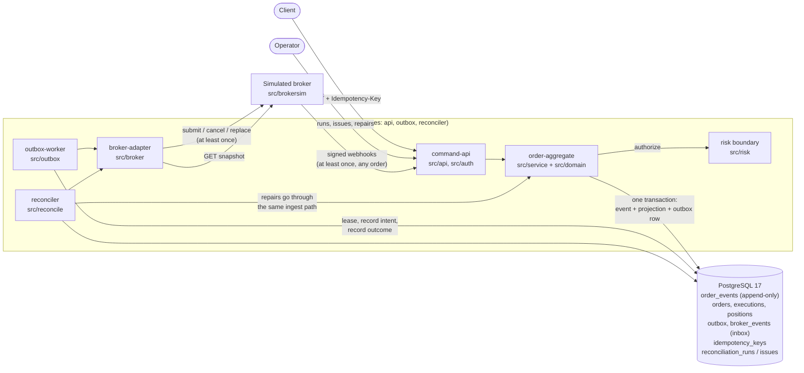
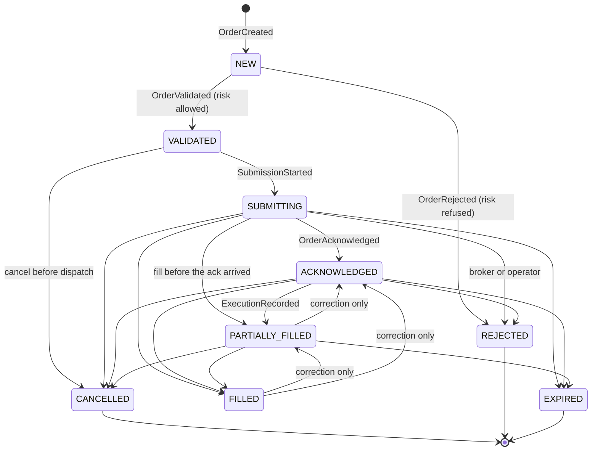

# Architecture

Simulated / paper trading only. The only broker is the simulator in `src/brokersim`.

## The problem

An order management system sits between clients that retry and a broker that retries. Requests time out after they were processed. Broker reports arrive twice, late, out of order, or not at all. The OMS has to keep one correct answer to "what is the state of this order, and how much of it traded" through all of that, and when its answer and the broker's differ it has to say so rather than quietly pick one.

The design follows from four rules:

1. **The event log is the truth.** An order is the fold of its events. Every table a reader queries (`orders`, `executions`, `positions`) is a projection written in the same transaction as the event, and `omsd verify` proves they match by replaying the log.
2. **Nothing crosses a process boundary inside a transaction.** A database transaction decides and records; a separate step talks to the broker; a third records what happened. The outbox connects them.
3. **Every input is deduplicated where it enters.** Client commands by idempotency key and client order id, broker reports by event id and by execution id, dispatcher calls by the order id and request id the broker deduplicates on.
4. **Disagreement is data.** A report that contradicts the order is quarantined into an exception queue with the evidence attached. Booked trades are never edited to make a discrepancy go away.

## Components

| Spec service | Package | Responsibility |
|---|---|---|
| command-api | `src/api`, `src/auth` | HTTP routing, authentication, authorization, body limits, webhook signature check, metrics endpoint |
| order-aggregate | `src/domain` (pure), `src/service` | The state machine and every decision; transactions that append events |
| outbox-worker | `src/outbox` | Leases outbox rows and delivers them to the broker with retry, backoff and dead-lettering |
| broker-adapter | `src/broker` | The broker client interface, HTTP client, webhook wire format and signature |
| reconciler | `src/reconcile` | Compares the OMS with a broker snapshot; repairs or raises issues |
| (boundary) | `src/risk` | Pre-trade authorization interface with a small static-limits implementation |
| (storage) | `src/store` | PostgreSQL schema, event append, projections, outbox, inbox, issues, `Verify` |
| (wiring) | `src/app` | Builds the system from configuration; used by `omsd`, the demo, the benchmark and the tests |

All roles live in one binary. `OMS_ROLES` selects which a process runs, so the API, the dispatcher and the reconciler can be scaled or restarted separately. Any number of processes can share one database: the outbox uses row leases, and reconciliation uses an advisory lock.

## State machine

The table is `domain.Transitions`. `domain.Apply` refuses any event that would make a transition not in it, and the unit test `TestTransitions_ApplyAndTheTableAgreeExactly` checks the two against each other in both directions.

- **Backward transitions** happen only through `ExecutionCorrected` and `ExecutionBusted`, the broker restating or cancelling an earlier execution. Nothing else can lower an order's progress.
- **Closed orders stay closed**, but their totals can still change: a fill that the broker executed before a cancel took effect is booked on the cancelled order and marked `late`, because it is a real trade.
- **Filled quantity never exceeds order quantity** unless an operator explicitly accepts a quarantined execution (`ExecutionAccepted`), which records who and why.
- Cancel and replace are requests. The order carries `pending_cancel` / `pending_replace` until the broker confirms or refuses; the state changes only on the broker's word.

## Write path: a command

`POST /v1/orders` in one transaction:

1. Claim the idempotency key for this principal. If it exists with the same request hash, return the stored response byte for byte. If it exists with a different hash, refuse (422). If another request with this key is still running, 409.
2. Validate, ask the risk authorizer. If risk cannot answer, fail closed (503, nothing stored).
3. Append `OrderCreated` and `OrderValidated` (or `OrderRejected`), update the `orders` projection, insert a `SUBMIT_ORDER` outbox row, store the response under the key.

Either all of that commits or none of it does. There is no window in which an order exists without its submission queued, or a submission is queued for an order that was not saved.

## Outbox dispatch

Each message is handled in three steps so that no database lock is held during a broker call:

1. **Intent** (transaction, order locked). Decide whether the call is still needed. A submission for an order that was cancelled meanwhile, or that the broker already acknowledged, is marked `SKIPPED`. Otherwise append `SubmissionStarted` (first attempt only).
2. **Call** the broker, with the order id as the broker's deduplication key (or a request id for cancel and replace).
3. **Outcome** (transaction). `DELIVERED`; or scheduled for retry with exponential backoff and jitter; or `REJECTED` when the broker understood and refused; or `DEAD` after `MaxAttempts`, which raises an `OUTBOX_DEAD_LETTER` issue and leaves the order exactly as it is.

Properties:

- **At-least-once.** A worker that dies after step 2 leaves a lease that expires; another worker sends again; the broker deduplicates. The OMS never assumes the broker is exactly-once and never assumes a failed call did not happen.
- **Per-order ordering.** A message is only leased when no earlier undelivered message exists for the same order, so a cancel cannot overtake its submission.
- **Only clear refusals are final.** 400, 404, 409 and 422 mean the broker refused this request. Timeouts, connection errors, 5xx, 408, 429 and also 401/403 are retried, so an outage or a bad credential cannot turn into a wave of rejected orders.
- **Shutdown is safe.** In-flight calls finish and record their outcome; a claim is never committed without a worker to work it.

## Read path: a broker report

Webhooks are verified (HMAC-SHA256 over the raw body), normalized, and handed to `Service.IngestBrokerReport`, in one transaction:

1. Insert into the inbox (`broker_events`) by event id. A repeat returns the first outcome as `DUPLICATE`.
2. Lock the order. Look up the execution id and the execution it references.
3. `domain.DecideReport` returns one of:

| Outcome | Meaning | Effect |
|---|---|---|
| `APPLIED` | New information | Events appended, projections updated |
| `DUPLICATE` | Same event id, or same execution id with identical terms | Nothing |
| `STALE` | Describes something the order is already past (a late ack, a cancel confirmation after a fill) | Recorded in the inbox only |
| `QUARANTINED` | Contradicts the order: overfill, execution on a rejected order, same execution id with different terms, second correction of one execution | Issue raised with the report attached; order untouched |
| `UNKNOWN_ORDER` | No such order here | `ORPHAN_BROKER_EVENT` issue |

The webhook answers 200 for every one of those (the report is durably recorded; do not resend), 400 for a body that is not a usable report, 401 for a bad signature and 503 when it could not be recorded, which tells the broker to retry.

**Order independence.** Execution records commute: a correction carries its own terms and the id of what it replaces, its effect is `own - referenced`, and a record that arrives after its own replacement is booked as already superseded. Any arrival order of a set of fills, corrections and busts gives the same totals. `TestProperty_ExecutionRecordsCommute` checks 300 random histories; `TestScenario_AnyDeliveryOrderConverges` shuffles real webhook deliveries with 40 seeds.

## Reconciliation

A run takes the advisory lock (one run at a time across all processes), fetches the broker's snapshot, and compares:

| Finding | What it means | Action |
|---|---|---|
| `MISSING_EXECUTION` | Broker has an execution the OMS has not booked | Booked automatically, through the same ingest path as a webhook, attributed to `RECONCILER` |
| `MISSED_REPORT` | Broker shows the order acknowledged, replaced as requested, cancelled, rejected or expired and the OMS never heard | Applied automatically, same path |
| `EXECUTION_MISMATCH` | Both have the execution, with different quantity, price or fee | Issue. The booked trade is not changed |
| `PHANTOM_EXECUTION` | OMS booked an execution the broker does not have | Issue |
| `STATE_MISMATCH`, `QUANTITY_MISMATCH` | The books differ and the broker is not simply ahead | Issue |
| `MISSING_AT_BROKER` | OMS sent an order the broker has no record of | Issue; an operator may reject the order after the OMS re-checks with the broker |
| `ORPHAN_BROKER_ORDER` | Broker has an order the OMS does not | Issue |

Why only the first two are automatic is in [ADR 0002](decisions/0002-reconciliation-repairs.md).

- **Grace window.** Anything that changed in the last few seconds is skipped, so in-flight activity is not mistaken for drift. Broker records are aged on the broker's clock and OMS records on the local clock, so skew between them cannot make fresh activity look old.
- **Issues are deduplicated** by a fingerprint of what they describe, and an issue that describes a visible difference is closed automatically when a later run examines the order and no longer sees it.
- **A failed snapshot fails the run**, records it as `FAILED`, and opens or closes nothing.

## Data model

| Table | Role |
|---|---|
| `order_events` | Append-only log; `(order_id, version)` unique. Triggers refuse UPDATE, DELETE and TRUNCATE |
| `orders` | Projection of the fold; optimistic `version`; `(account_id, client_order_id)` unique |
| `executions` | One row per broker execution record (fill, correction, bust) with its signed delta. Append-only by trigger; broker execution id unique |
| `positions` | Net quantity and cash per account and symbol, summed from execution deltas |
| `outbox` | Broker calls to make: status, attempts, lease, next attempt time |
| `broker_events` | Inbox: every report received, by event id, with its raw body and outcome |
| `idempotency_keys` | Per-principal key, request hash, stored response bytes |
| `reconciliation_runs`, `reconciliation_issues` | Run history and the exception queue |

Money is `fixed.Micros`, an `int64` count of millionths, parsed from and printed as decimal strings and never passed through a float. Multiplications check for overflow and refuse rather than wrap. Quantities are whole units.

Every timestamp is UTC. Events and executions carry two: `occurred_at` / `executed_at` is event time (the broker's clock for broker reports) and `recorded_at` is the local receive time. Ordering and state never depend on the broker's clock.

## Security boundaries

| Boundary | Where | Rule |
|---|---|---|
| Authentication | `src/auth`, `api.authed` | Bearer tokens, looked up by SHA-256 hash. No keys configured means the process does not start |
| Authorization | `auth.Principal`, `service.authorizeOrder` | Traders trade and read their accounts; viewers read theirs; operators read everything, run reconciliation and repair, and cannot trade. Orders outside a caller's accounts answer 404 |
| Risk | `src/risk` | Asked before every create and replace. No answer means refusal |
| Execution | `src/outbox`, `src/broker` | The only code that sends anything to a broker; reached only through an outbox row written by the aggregate |
| Broker ingress | `api.webhook` | HMAC signature over the raw body; no secret configured means webhooks are refused |

Secrets come only from the environment or a mounted file. They are never logged: `TestProcesses_KillAndRestartDrainsTheOutbox` runs both binaries at debug level and searches their output for every credential, and `TestRepository_ContainsNoCredentials` scans the repository.

`omsd` refuses to start unless the broker at `OMS_BROKER_URL` identifies itself as simulated.

## What happens when things fail

| Failure | Behaviour |
|---|---|
| Client retries a create | Stored response replayed; one order |
| Two requests race with one key | One runs; the other gets the stored response or 409 `REQUEST_IN_PROGRESS` |
| Broker is down | Order is accepted and durable; dispatch retries with backoff; dead-letters after `MaxAttempts` |
| Broker processed a call but the response was lost | Retry; the broker deduplicates; one broker order |
| Outbox worker is killed mid-call | Lease expires; another worker resends; same as above |
| Webhook delivered twice | `DUPLICATE` |
| Webhooks out of order | Same final state in any order |
| Webhook lost | Reconciliation books it from the snapshot |
| Broker reports an impossible fill | Quarantined; issue; books unchanged |
| Broker's clock is wrong | Only event-time fields and the lag metric are affected; a counter records reports stamped in the future |
| Database refuses a write (lock timeout, outage) | The command or webhook fails with 503 and nothing partial is stored; the caller retries |
| Risk engine unavailable | 503; no order is created |
| OMS process killed | On restart the outbox drains; nothing accepted is lost |

Each row is a test; see [test-report.md](test-report.md).
