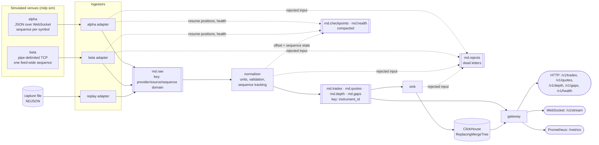

# Architecture

All data the platform ingests by default is simulated. There is no order entry
and no connection to any real venue or account.

## Data flow

The log (`stream`) is Redpanda or any Kafka-protocol broker. The store
(`storage`) is ClickHouse. Both sit behind interfaces (`stream.Bus`,
`storage.Store`) with an in-memory implementation each, which is what the
hermetic tests, `mdp standalone`, `mdp demo` and `mdp replay` run on. One
contract test suite per interface (`tests/contract`) runs against both the
in-memory and the real implementation, so the in-memory ones are held to the
behaviour the real ones show.

## Services

| Service | Command | Reads | Writes | State it needs to resume |
| --- | --- | --- | --- | --- |
| ingestors | `mdp ingest` | provider sockets or a capture file | `md.raw`, `md.rejects`, `md.health` | per sequence domain: session and last published sequence number (`md.checkpoints`) |
| normalizer | `mdp normalize` | `md.raw` | `md.trades`, `md.quotes`, `md.depth`, `md.gaps`, `md.rejects` | per raw partition: next offset and the sequence tracker as of that offset, in one record (`md.checkpoints`) |
| stream | (library, `src/stream`) | | | topics, partitioning, lag |
| storage | `mdp sink` | canonical topics | ClickHouse, `md.rejects` | consumer group offsets, committed after rows are stored |
| gateway | `mdp gateway` | canonical topics from the log end, `md.health`, ClickHouse | HTTP and WebSocket responses | none |

`mdp sim` is the simulated venue pair, with an HTTP fault-injection endpoint.
`mdp standalone` runs the simulator and all services in one process on the
in-memory log and store.

## Canonical schema

Defined in `src/domain`. Every trade, quote and depth snapshot carries:

| Field | Meaning |
| --- | --- |
| `instrument_id` | `<venue>:<native_symbol>`, from reference data |
| `event_time` | the venue's clock, exactly as the provider supplied it (UTC) |
| `receive_time` | the ingestor host's clock when the frame was read off the socket (UTC) |
| `provider`, `session`, `seq_domain`, `seq` | where the event came from in the provider's own numbering |
| `source` | `live` or `replay` |
| `normalizer_version` | rule set that produced the event |
| `flags` | `clock_skew`, `stale`, `locked`, `no_bid`, `no_ask` (valid but noteworthy) |

Kinds: `trade` (`trade_id`, `price_ticks`, `quantity`, `aggressor`), `quote`
(`bid_ticks`, `bid_size`, `ask_ticks`, `ask_size`), `depth` (`bids`, `asks` as
lists of `price_ticks`/`quantity`, best first), and `gap` (`from_seq`,
`to_seq` that never arrived).

**No floating point.** Prices are integer multiples of the instrument's
`tick_size` and sizes integer multiples of its `lot_size` (`src/fixed`).
Provider decimals are parsed as strings; a value that is not an exact multiple
is rejected (`PRICE_NOT_ON_TICK`, `QUANTITY_NOT_ON_LOT`), never rounded. API
responses return the tick and lot size next to the integers.

The two example providers differ on purpose: wire format, transport, sequence
scope, price encoding (decimal string vs. integer scaled by 10⁴), timestamp
encoding (RFC 3339 nanoseconds vs. epoch microseconds) and which side a trade
reports (aggressor vs. resting order). The normalizer maps all of it onto the
one schema.

## Clocks

Three clocks exist and they are never mixed or substituted for each other.

| Timestamp | Clock | Used for |
| --- | --- | --- |
| `event_time` (`event_ts` in ClickHouse) | venue | query ranges, sort order, partitioning, retention of events |
| `receive_time` (`recv_ts`) | ingestor host | pipeline latency, gap time, retention of gaps |
| `persist_ts` | ClickHouse server | choosing the latest version of a redelivered row; storage only |

- The normalizer never rewrites `event_time`. An event whose venue time is
  ahead of the receive time by more than 250 ms is flagged `clock_skew`; one
  more than 5 s behind is flagged `stale`. Both are kept.
- `mdp_feed_lag_seconds` and `lag_ms` are `receive_time − event_time`. They
  span two clocks and are labelled as such; they can be negative.
- `mdp_pipeline_latency_seconds` (stages `normalized`, `stored`, `delivered`)
  is measured from `receive_time` on platform clocks only.
- WebSocket freshness (`age_ms`, `stale`) is measured on the gateway's clock
  from when the gateway last saw an event, so a wrong venue clock cannot make
  a dead feed look alive.
- Every response that carries timestamps includes a `clocks` object saying
  which clock each field comes from.

**Accepted range.** Timestamps must lie strictly between 1970-01-01 and
2100-01-01 UTC. The normalizer rejects anything else
(`EVENT_TIME_OUT_OF_RANGE`), and both store adapters refuse it before writing.
The reason is a measured ClickHouse behaviour: an earlier schema accepted a
row dated 2107 and then deleted it without an error. See
[ADR 0004](decisions/0004-bounded-timestamp-range.md).

## Topics, partitioning and ordering

| Topic | Key | Partitions | Retention | Contents |
| --- | --- | --- | --- | --- |
| `md.raw` | `provider/source/seq_domain` | 4 | 24 h | parsed provider events, provider units and symbols |
| `md.trades`, `md.quotes`, `md.depth` | `instrument_id` | 4 | 7 d | canonical events |
| `md.gaps` | `instrument_id`, or venue for feed-wide gaps | 4 | 7 d | declared sequence gaps |
| `md.rejects` | provider or reason | 1 | 14 d | dead letters from every stage, with reason and original payload |
| `md.health` | `provider/source` | 1 | compacted | latest `IngestHealth` |
| `md.checkpoints` | `feed/<provider>/<source>`, `normalizer/md.raw/<partition>` | 1 | compacted | `FeedOffset`s and normalizer state |

The partition count is `--partitions` (default 4). `EnsureTopics` fails if an
existing topic has a different count, because routing depends on it.
Partitioning is an explicit FNV-1a hash of the key (`stream.PartitionFor`),
not the client library's default, so a key lands on the same partition with
either log implementation and across library upgrades; a unit test pins it.

**Ordering guarantee.** Events of one provider sequence domain are in provider
order in `md.raw`, and events of one instrument are in that order in each
canonical topic. Nothing is promised across partitions, across topics, or
across venues: there is no universal total order, by design. Consumers that
need to merge venues must do so on `event_time` with their own tolerance.

A topic prefix (`--namespace` / `MDP_KAFKA_NAMESPACE`) applies to every topic
and consumer group, so several deployments or test runs can share a cluster.

## Delivery semantics and deduplication keys

Every hop is **at least once**. Nothing claims exactly-once delivery; instead
each hop has a key that makes redelivery harmless.

| Hop | What can repeat | What absorbs it |
| --- | --- | --- |
| provider → ingestor | provider resends after a reconnect or on its own | ingestor accepts an event only if it advances its sequence domain (`mdp_ingest_duplicates_total`) |
| ingestor → `md.raw` | ingestor crashes after publishing and before checkpointing, then republishes | normalizer's sequence tracker drops `seq ≤ last` (`mdp_duplicates_total`) |
| `md.raw` → canonical topics | normalizer crashes after publishing and before checkpointing, then reprocesses | repeats carry the same deduplication key; see below |
| canonical → ClickHouse | sink crashes after inserting and before committing offsets | the table sorting key is the deduplication key (`ReplacingMergeTree`) |
| canonical → WebSocket | same repeats as above | gateway remembers the highest `seq` per topic, instrument and session and does not forward anything at or below it (`mdp_ws_duplicates_suppressed_total`) |

Deduplication keys, which are also the ClickHouse sorting keys:

| Fact | Key |
| --- | --- |
| trade | `instrument_id, event_time, trade_id` (venue-assigned id) |
| quote, depth | `instrument_id, event_time, seq` (provider sequence number) |
| gap | `provider, session, seq_domain, from_seq` |

A redelivered fact has the same `event_time` because it is the same venue
fact, so including it in the key is safe and lets ClickHouse deduplicate
within one daily partition.

`ReplacingMergeTree` removes repeats during background merges, at a time of
its choosing. Until then both copies are on disk. Every query the platform
issues therefore uses `FINAL`, so a repeat is never visible to a reader,
merged or not. The integration test shows 800 physical rows and 400 visible
ones after a full redelivery.

The order of operations is what makes loss impossible on each hop:

- ingestor: publish, wait for the broker's acknowledgement, then checkpoint.
  A checkpoint never claims an event the log does not hold.
- normalizer: publish every output of a batch, then checkpoint offset and
  sequence state together in one record. The two cannot disagree after a
  restart, so a gap cannot slip through one and a repeat is always recognised.
- sink: insert, then commit offsets.

## Sequence tracking and gaps

`src/seqtrack` is the one definition of in-order, duplicate, gap and session
reset, shared by ingestors and normalizer.

1. **Recover first.** When a live provider skips sequence numbers, the
   ingestor does not publish past the hole. It reconnects and asks the
   provider to resend from the last number it holds
   (`mdp_ingest_resyncs_total`). It asks once per hole.
2. **Declare what cannot be recovered.** If the provider cannot supply the
   range, the event after the hole is published and the normalizer writes a
   gap record `[from_seq, to_seq]` to `md.gaps`. The sink stores it, the
   gateway pushes a `gap` message to every affected live subscriber and serves
   it from `GET /v1/gaps`. A gap in a feed-wide sequence carries no
   `instrument_id`: it may affect any instrument of the venue, and is reported
   for all of them.
3. **Session change.** A new provider session restarts sequence tracking
   (`mdp_session_resets_total`); numbers from different sessions are never
   compared.

### Joining a session late

A tracker that has never seen a sequence domain cannot tell event 1 from event
500. If reference data states the provider's first sequence number
(`seq_start`), then a first sighting, or the first event of a new session,
with a higher number means the start was missed. The ingestor asks the provider
to resend the session from its start; if that fails, the normalizer declares
`[seq_start, seq − 1]` as a gap. The deployed stack exercises this on every
cold start (the venues are already publishing when the ingestors connect) and
the failure demo's baseline audit shows every domain complete from sequence 1.

## Backpressure

Slowness turns into lag that can be measured. It is not turned into drops.

- **Broker slow or down.** `Produce` returns only when records are
  acknowledged. The ingestor retries the same batch and reads nothing from the
  provider meanwhile. When it reconnects it resumes from its last acknowledged
  position, so the provider's resend covers the outage.
- **ClickHouse slow or down.** The sink retries the same batch forever with
  backoff and reads nothing new. The backlog stays in the canonical topics and
  shows as `mdp_consumer_lag_records{consumer="sink"}`; `mdp_sink_retrying` is
  1. Historical queries return `503 STORE_UNAVAILABLE`. Live WebSocket
  delivery is unaffected because it does not go through the store.
- **A row the store will never accept.** Retrying cannot help, so the sink
  bisects the batch to the offending rows, writes the rest, and dead-letters
  those rows to `md.rejects` with reason `STORE_REJECTED`
  (`mdp_sink_rejected_rows_total`). One bad row does not block the pipeline
  and is not lost from sight.
- **A slow WebSocket client.** Each subscriber has a bounded queue (1,024
  messages). The hub never blocks on a subscriber. When a queue is full, the
  event is not delivered to that subscriber, the miss is counted
  (`mdp_ws_dropped_total`), and the subscriber receives
  `{"type":"gap","reason":"slow_consumer","dropped":N}` as soon as its
  connection moves again, sent outside the queue so a full queue cannot
  suppress its own drop report. This is the only place events are dropped, it
  affects only that client's live view, and the client is told how many. The
  stored history is complete and can be queried to fill in.

Lag is exported per consumer, topic and partition
(`mdp_consumer_lag_records`), and the time a restarted consumer took to reach
the log end as `mdp_consumer_catchup_seconds`.

## Storage

Tables `trades`, `quotes`, `depth`, `feed_gaps` and `instruments`; DDL in
`src/storage/clickhouse.go`. Event tables are `ReplacingMergeTree(persist_ts)`,
partitioned by `toDate(event_ts)`, ordered by the deduplication key, with
column comments naming the clock of each timestamp.

**Query retention.**

| Table | Retention | Measured on |
| --- | --- | --- |
| `trades` | 90 days | `event_time` |
| `quotes` | 30 days | `event_time` |
| `depth` | 7 days | `event_time` |
| `feed_gaps` | 90 days | `receive_time` (a gap has no venue timestamp) |

Retention is a ClickHouse `TTL` on the 64-bit timestamp column. Queries cannot
return older data, and every
query response says so (`retention.days`, `retention.oldest_queryable`,
`retention.measured_on`). An event that arrives already older than its table's
retention is dead-lettered by the sink as `OLDER_THAN_RETENTION` rather than
inserted and silently expired. Retention longer than five years is refused at
start-up. Changing retention on an existing table needs
`ALTER TABLE … MODIFY TTL`; `Migrate` only creates what is missing.

Inserts are synchronous (`async_insert=0`) so an acknowledged insert has been
checked and written.

`mdp archive --date YYYY-MM-DD` exports a day of trades and quotes to Parquet
(`<out>/<table>/date=…/instrument=…/part-0.parquet`), in store order, written
to a temporary name and renamed.

## Gateway

HTTP queries are keyset-paginated on `(event_time, tie-breaker)` over the
half-open range `[from, to)`, so pages neither skip nor repeat rows when many
events share a timestamp. The API is listed in the [README](../README.md#api).

`WS /v1/stream?instrument_id=a,b&channels=trade,quote,depth` sends JSON text
frames:

| `type` | When |
| --- | --- |
| `subscribed` | once, first: instruments, channels, heartbeat interval, stale threshold, queue size, clocks |
| `trade`, `quote`, `depth` | canonical events, as stored |
| `gap` with `reason: "feed_gap"` | the upstream feed lost `from_seq..to_seq` |
| `gap` with `reason: "slow_consumer"` | this connection missed `dropped` events for an instrument |
| `status` | every second, per instrument: `last_event_time`, `last_receive_time`, `age_ms`, `stale`, `feed_gaps`, `dropped` |

Live delivery starts at the end of the log; history comes from the query API.

Entitlements are per venue. The gateway is open when no entitlements file is
configured, which is intended for local simulated data only. With a file,
callers present `Authorization: Bearer <token>`; the file stores SHA-256
digests of tokens, comparison is constant-time, and tokens in the URL are
ignored so they cannot end up in access logs. Store errors are returned as a
generic message because the underlying error can contain connection details.

## Replay and determinism

A capture file is the provider frames as read off the wire plus the receive
time of each (`mdp ingest --capture`). The replay adapter feeds a capture
through the same parsers and the same pipeline, using the recorded receive
times, and labels the output `source: replay`. Replay is sequence-tracked
separately from the live feed of the same provider, so replaying into a
running pipeline does not disturb live gap detection. The store key does not
include the source: a replayed fact that is already stored collapses onto the
existing row.

`mdp replay` runs a capture through an in-memory pipeline and hashes the
canonical and reject topics. Records are ordered by topic, key, then position
within the key before hashing: order within a key is fixed by the provider's
own sequence, order across keys depends on goroutine scheduling and is
excluded on purpose. The committed capture and its expected digest are checked
by `make replay` and by the scenario tests; regenerating the capture produces
identical bytes.

## Configuration and secrets

Flags and environment variables are listed by `mdp <command> -h`. The only
secret is the ClickHouse password, read from `MDP_CLICKHOUSE_PASSWORD`. `make
setup` writes a random one to `.env` (mode 600, ignored by git). It is passed
in an HTTP header, never in a URL, and is not logged. Compose publishes every
port on 127.0.0.1 only.

## Known limitations

- **One instance per service.** Consumers are assigned all partitions
  directly; there is no consumer-group rebalancing. Running two normalizers or
  two sinks is safe for the store (deduplication keys) but doubles the work
  and the canonical log's repeats. Scaling out needs partition assignment.
- **`md.raw` is keyed by sequence domain**, because gap detection needs one
  domain's events in order in one place. A provider with a single feed-wide
  sequence therefore uses one raw partition. With the example reference data,
  the four sequence domains hash onto two of the four partitions.
- **Without `seq_start`**, joining a session late declares nothing: the
  platform cannot know what preceded the first event it saw.
- **Loss at the tail of a session**, or of a whole session never seen, cannot
  be detected from sequence numbers alone: a hole is revealed only by the next
  event after it. The beta heartbeat carries the last sequence number sent,
  which would bound this, but the adapter does not use it.
- **A false start-of-session gap is possible** if the normalizer's checkpoint
  is lost *and* retention has already trimmed the start of `md.raw`: the
  normalizer then first sees the session mid-way. It errs towards declaring a
  gap that did not happen rather than hiding one that did.
- **Sessions are assumed to be feed-wide** per provider.
- **WebSocket duplicate suppression is in memory.** A gateway restart begins
  at the log end, so it does not replay, but the marks are lost.
- **Shutdown during a broker outage.** If an ingestor is stopped while it
  holds a batch it could not publish, those events are re-requested from the
  provider on the next start. If the provider can no longer resend them, they
  become a declared gap.
- **Reference data is a file** loaded at start-up; changing it means a
  restart. Changing an instrument's tick size re-interprets nothing already
  stored, and is not versioned.
- **Single-node development infrastructure.** Compose runs one Redpanda broker
  and one ClickHouse server with replication factor 1. Durability across node
  loss is a deployment concern this project does not exercise.
- **Not implemented:** a schema registry, tiered storage beyond the Parquet
  export, TLS termination, and rate limiting on the gateway.
