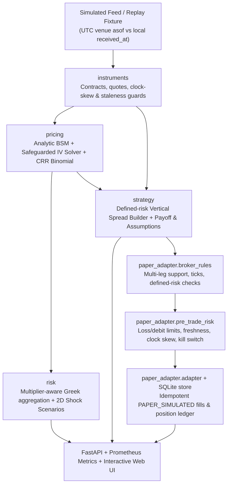

# Architecture — Options Trading Infrastructure

## System Pipeline

## Module Boundaries

| Service | Module | Responsibility | Numeric Boundary |
| --- | --- | --- | --- |
| `domain` | `options_infra.domain` | Immutable UTC-aware schemas, warnings, pricing assumptions | `Decimal` money/strikes; `float` analytic Greeks |
| `instruments` | `options_infra.instruments` | Contract metadata, deterministic chain simulator, replay fixtures, staleness/skew/disconnect checks | `Decimal` quotes & ticks |
| `pricing` | `options_infra.pricing` | European Black–Scholes–Merton (`r`, `q`), safeguarded Newton+bisection IV solver, CRR binomial tree (stretch) | IEEE 754 `float64` via stdlib `math` |
| `risk` | `options_infra.risk` | Signed `quantity × multiplier` Greek aggregation, per-underlying breakdown, 2D spot × vol × time shock engine | `float64` Greeks; `Decimal` mark/cost/PnL |
| `strategy` | `options_infra.strategy` | 4 vertical spread structures, exact max loss/gain/breakeven, expiration & T+0 payoff curves with explicit assumptions | Exact `Decimal` risk & payoff math |
| `paper-adapter` | `options_infra.paper_adapter` | Separated broker capability rules, pre-trade risk gate, SQLite idempotent store, `PAPER_SIMULATED` order lifecycle | Fixed-point `Decimal` exclusively |
| `metrics` | `options_infra.metrics` | Prometheus + JSON gauges/histograms/counters for parity error, IV convergence, risk latency, exposure, order status | Isolated `CollectorRegistry` |
| `api` & `web` | `options_infra.api`, `web/` | REST endpoints (`/v1/...`), health, metrics, self-contained HTML/SVG chain + payoff + scenario workstation | Pydantic v2 validation |

## Safety & Operational Invariants

1. **Paper/Simulated Only:** Every order schema enforces `execution_mode = "PAPER_SIMULATED"`; there is no real-money broker transport or credential store.
2. **Timestamp Integrity:** Naive timestamps are rejected. Every `OptionQuote` separates venue event time (`asof`) from local receive time (`received_at`), enabling explicit staleness and clock-skew detection.
3. **Explicit Model Boundaries:** Pricing an `AMERICAN` contract under European BSM always emits `AMERICAN_PRICED_WITH_EUROPEAN_BSM` and suggests `BINOMIAL_CRR`. Every payoff diagram embeds `PricingAssumptions`, `limitations`, and `PIN_AND_ASSIGNMENT_RISK`.
4. **Separated Control Planes:** Broker capability validation (`broker_rules.py`), pre-trade risk (`pre_trade_risk.py`), and simulated execution/storage (`adapter.py`, `store.py`) are independent modules tested in isolation and end-to-end.
