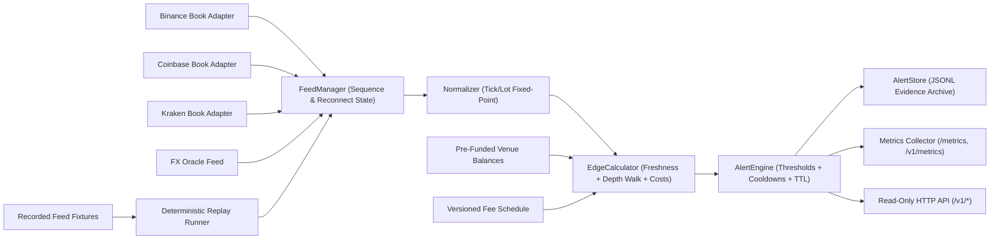

# Architecture — Cross-Exchange Arbitrage Monitor

## Overview

The Cross-Exchange Arbitrage Monitor is a **read-only, paper-by-default** scanner that ingests multi-venue top-N order books, normalizes symbols and fixed-point precision, enforces strict quote freshness and sequence-integrity gates, calculates depth-aware net arbitrage edge after fees/FX/slippage/inventory constraints, and persists auditable alert evidence.

## Module Responsibilities

| Package | Path | Responsibility |
| --- | --- | --- |
| `fixed` | `src/fixed` | Exact 1e8 fixed-point `Decimal` arithmetic (`int64` + `math/big` intermediates). Eliminates binary floating-point rounding drift across all price, quantity, fee, FX, and bps paths. |
| `domain` | `src/domain` | Canonical domain models (`VenueBook`, `InstrumentSpec`, `VenueFee`, `FXRate`, `VenueBalance`, `Opportunity`, `Alert`, `AlertEvidence`, `AlertConfig`, `VenueHealth`, `TransferCostEstimate`). |
| `normalizer` | `src/normalizer` | Maps venue-native symbols (`BTCUSDT`, `BTC-USD`, `XBT/USDT`) to canonical instruments, conservatively rounds bids down and asks up to tick size, floors quantities to lot size, truncates top-N levels, and rejects crossed single-venue books. |
| `connectors` | `src/connectors` | Exchange-specific decoders (Binance, Coinbase, Kraken), per-venue/instrument sequence validator (duplicate, out-of-order, gap detection), disconnect/reconnect state machine requiring snapshot resync, and JSONL recorded-feed reader. |
| `edgecalculator` | `src/edgecalculator` | Quote-age, clock-skew, and inter-leg skew filters; FX normalization; level-by-level cross-book depth walker stopping when marginal net profit turns non-positive; taker fee + min-fee + FX spread + modeled slippage deductions; pre-funded inventory caps; separated off-band withdrawal cost estimates. |
| `alertengine` | `src/alertengine` | Versioned `AlertConfig` management, per-pair cooldown enforcement, alert TTL expiry, immutable evidence snapshotting, durable fsynced JSONL persistence, and active-opportunity query index. |
| `metrics` | `src/metrics` | Thread-safe operational metrics (gross/net edge bps, histograms, executable notional, alert staleness & lifetime, suppression breakdown, venue disconnect/reconnect/gap counters) exported as JSON and Prometheus exposition text. |
| `replay` | `src/replay` | Event-clock-driven deterministic replay engine with SHA-256 alert digest verification and optional post-trigger paper adverse-selection lookahead diagnostics. |
| `api` | `src/api` | Read-only REST API (`/v1/opportunities`, `/v1/alerts`, `/v1/venues/health`, `/v1/alerts/config`, `/v1/balances`, `/v1/metrics`, `/metrics`, `/healthz`). |

## Key Invariants

1. **Zero Floating-Point Execution Math:** Prices, quantities, notionals, taker fees, FX conversions, slippage, and bps edges use `fixed.Decimal` exclusively.
2. **UTC Dual-Timestamp Tracking:** Every `VenueBook` records both venue event timestamp (`asof`) and local receipt timestamp (`received_at`) in UTC. Both legs must pass `max_quote_age_ms`, `max_clock_skew_ms`, and `max_leg_skew_ms`.
3. **Executable Depth Ceiling:** Matched opportunity quantity never exceeds available quoted depth on either leg (`qty <= min(sum(buy.Asks), sum(sell.Bids))`), never includes unprofitable deeper levels, and never exceeds pre-funded per-venue inventory when `enforce_inventory` is enabled.
4. **No Balance Teleportation:** Pre-funded inventory on the buy venue (quote asset) and sell venue (base asset) limits achievable quantity independently. On-chain withdrawal/rebalancing cost is reported separately with `included_in_edge: false`.
5. **Fail-Closed Feed State:** On disconnect or sequence gap, a venue's books are immediately excluded from opportunity detection until a full snapshot (`is_snapshot: true`) arrives after reconnect.
6. **Paper-Only Boundary:** No order routing, signing, or broker write endpoints exist. Every opportunity and alert embeds `"Alert: paper estimate, not an executable trade guarantee."`
