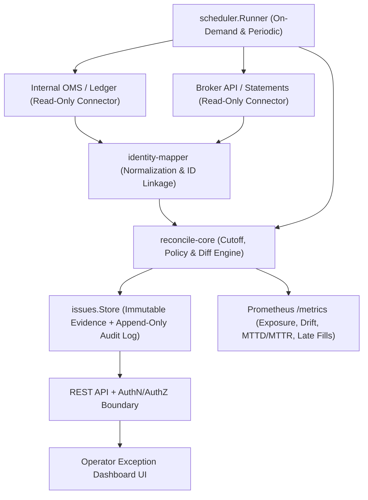

# Architecture — Broker Reliability & Reconciliation

## Overview

The Broker Reliability & Reconciliation service compares internal OMS/ledger state against broker API/statement records as of a strict UTC cutoff timestamp, surfaces typed discrepancies with immutable evidence, exposes Prometheus reliability SLIs, and provides a controlled Operator UI and REST API for triage and resolution.

## Module Boundaries

| Module | Path | Responsibility |
| --- | --- | --- |
| `domain` | `src/domain/` | Fixed-point `Decimal` (scale $10^8$, integer `big.Int`), immutable records, dual UTC timestamps (`event_time` vs `receive_time`), versioned `ReconPolicy`, typed `IssueKind` and `IssueEvidence`. |
| `connectors` | `src/connectors/` | Strictly read-only paginated `InternalConnector` and `BrokerConnector` interfaces, retry helper (`FetchAllPages`), simulated paper fixture adapters, and controlled `FaultProfile` injection. |
| `identity` | `src/identity/` | Canonicalizes symbols (`AAPL.US` -> `AAPL`, `BRK-B` -> `BRK.B`, alias overrides), ISO currencies, sides, UTC timestamps, and maintains `client_order_id` <-> `broker_order_id` <-> `broker_exec_id` maps. |
| `reconcile` | `src/reconcile/` | Deterministic cutoff filtering, SHA-256 input digesting, fill/order/position/cash comparison, duplicate/late/stale/clock-skew detection, and content-addressed issue ID derivation. |
| `issues` | `src/issues/` | Thread-safe work-queue store with validated lifecycle state transitions, owner assignment, resolution workflow, immutable original evidence protection, and append-only JSONL disk durability. |
| `scheduler` | `src/scheduler/` | Orchestrates on-demand and periodic reconciliation runs with pagination, bounded retries, error classification, and metrics emission. |
| `metrics` | `src/metrics/` | Renders Prometheus exposition format for open issues, monetary exposure, position drift, MTTD, MTTR, late-fill arrival histogram, run counters, and connector error counters. |
| `api` | `src/api/` | HTTP REST endpoints with separated `Authenticator` (constant-time API key / paper-mode dev) and `Authorizer` (RBAC `viewer` / `operator` / `admin`). |
| `operatorui` | `src/operatorui/` | Embedded offline-capable single-page Exception Dashboard visibly labeled **PAPER / SIMULATED**. |

## Explicit Non-Goals Enforced by Construction

1. **No ledger history overwrites:** `InternalConnector` exposes read-only `List*` methods only, and `issues.Store` never modifies `IssueEvidence` once captured.
2. **No automatic offsetting trades:** `BrokerConnector` exposes read-only `List*` methods only; resolutions record operator evidence or journal proposals rather than placing market orders.
3. **Strict settled vs. pending cash separation:** `CashSnapshot` keeps `SettledCash` and `PendingCash` distinct; `reconcile-core` evaluates `settled_cash_break` strictly against `SettledCash` so pending/settling funds never mask a settled cash discrepancy.
