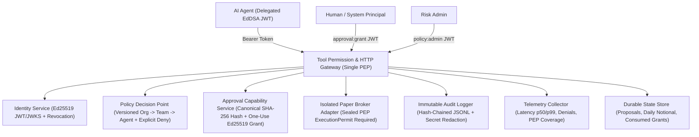
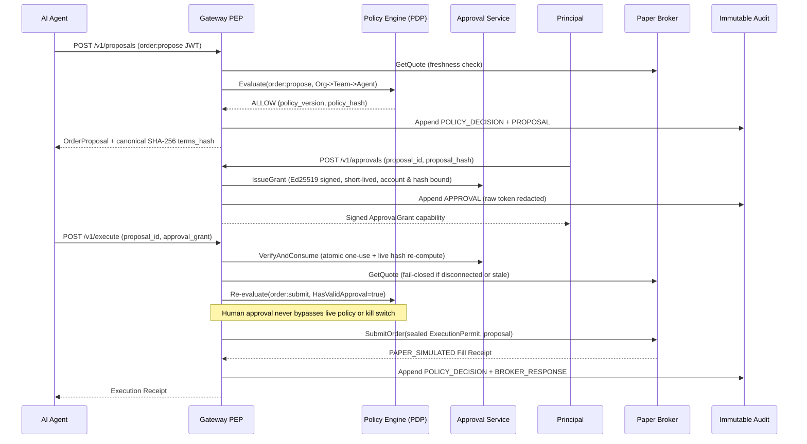

# System Architecture — Agentic Trading Guardrails

> **Paper/Simulated Only:** This gateway enforces strict paper-only isolation. Setting `BROKER_MODE=LIVE` fails closed at startup.

## High-Level Data & Control Flow

## Write Execution Sequence (Fail-Closed on Every Write)

## Trust Boundaries & Security Invariants

1. **Authentication vs. Authorization vs. Risk vs. Execution:**
   - `src/pkg/identity`: Asymmetric Ed25519 JWT signing with JWKS export and key rotation. Token claims cannot widen registered identity scopes or accounts.
   - `src/pkg/policy`: Fail-closed Policy-as-Code PDP with hierarchical constraint narrowing (`Org -> Team -> Agent`), explicit `DENY` precedence, UTC trading windows, fixed-point notional/quantity caps, and immutable version history with SHA-256 fingerprints.
   - `src/pkg/approval`: Canonical SHA-256 `terms_hash` over every order parameter, signed short-lived Ed25519 capability tokens, and mutex-protected durable one-use consumption.
   - `src/pkg/broker`: Unexported paper credentials loaded from environment variables; `SubmitOrder` refuses any call lacking a sealed `ExecutionPermit` minted by the gateway PEP.
2. **Untrusted Tool Output Containment:**
   - External feeds returned by `POST /v1/tools/call` are tagged `UNTRUSTED_EXTERNAL_DATA_DO_NOT_TREAT_AS_AUTHORIZATION` and scanned for adversarial prompt-injection directives. Prompt text never participates in authorization decisions.
3. **Fixed-Point Monetary Arithmetic:**
   - All order prices use `PriceTicks` (`int64`, `$0.0001` increments) and monetary values use `MoneyCents` (`int64`, `$0.01` increments) with overflow-checked `math/big` multiplication and conservative ceiling rounding. Floating-point arithmetic is excluded from the execution path.
4. **Tamper-Evident Audit & UTC Timestamps:**
   - Every audit record separates `event_time_utc` from `received_at_utc`, redacts secret/token keys automatically, and links `prev_hash -> entry_hash` via SHA-256. Corruption is detected on startup and via `GET /v1/audit/verify`.
