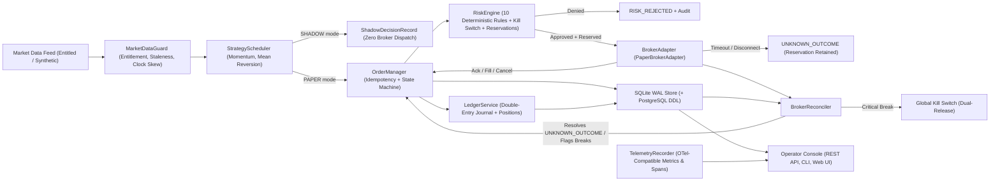
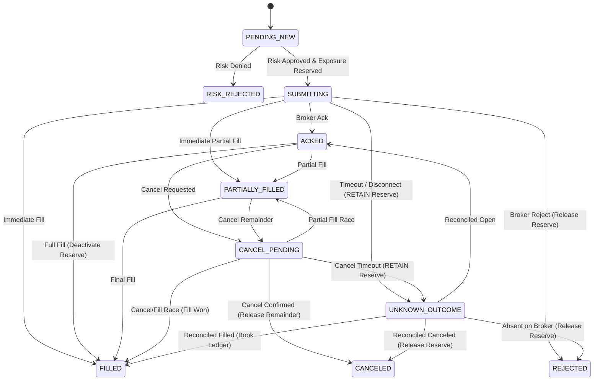

# Architecture & Component Boundaries

## 1. System Overview

The **Production Algorithmic Trading Platform** integrates market data validation, deterministic strategy execution, pre-trade risk checks with exposure reservation accounting, an idempotent Order Management System (OMS), a strict double-entry accounting ledger, broker reconciliation, observability, and an operator console into one paper-first deployable system.

## 2. Order Lifecycle State Machine

## 3. Component Boundaries

| Component | Module Path | Responsibility & Strict Boundary |
|---|---|---|
| **Canonical Contracts & Config** | `src/trading_platform/domain/` | Versioned Pydantic v2 contracts (`SCHEMA_VERSION = 1.0.0`), UTC timestamps, `Decimal` money/qty, structured errors, and fail-closed `ExecutionPolicyConfig` live gate. |
| **Market Data Guard & Strategy Runtime** | `src/trading_platform/strategy/` | Entitlement verification, staleness & clock-skew quarantine, point-in-time deterministic strategies (`MomentumCrossoverStrategy`, `MeanReversionStrategy`), and shadow-mode isolation. |
| **Risk Gate & Kill Switch** | `src/trading_platform/risk/` | 10 deterministic pre-trade rules evaluated in fixed order, atomic open/unknown exposure reservations, scoped kill switches (`GLOBAL`, `STRATEGY`, `SYMBOL`), and Maker-Checker dual release. |
| **Idempotent OMS** | `src/trading_platform/oms/` | Idempotency key + SHA-256 payload fingerprint enforcement, strict state transition table, cancel/fill race resolution, and `UNKNOWN_OUTCOME` reservation retention. |
| **Double-Entry Ledger** | `src/trading_platform/ledger/` | Strict `debits == credits` journal per currency, average-cost inventory & short liability tracking, idempotent fill posting (`FILL:{fill_id}`), realized/unrealized PnL, and trial balance. |
| **Broker Adapter** | `src/trading_platform/broker/` | Clean `BrokerAdapter` interface isolating venue protocols from business logic; `PaperBrokerAdapter` provides deterministic fills and explicit fault injection. |
| **Reconciliation Engine** | `src/trading_platform/reconciliation/` | Resolves `UNKNOWN_OUTCOME` orders against broker state, compares orders/positions/cash/reservations, persists reports, and engages dual-release kill switch on critical breaks. |
| **Storage & Audit** | `src/trading_platform/storage/` | Thread-safe SQLite WAL persistence with SHA-256 hash-chained append-only audit trail (`verify_audit_chain()`) plus PostgreSQL-compatible schema ([schema.sql](schema.sql)). |
| **Observability & Operator Console** | `src/trading_platform/observability/`, `api/`, `cli.py`, `web/` | OTel-compatible counters/gauges/latency histograms/spans, RBAC REST API, `patp` CLI, and zero-CDN Operator Console UI. |
