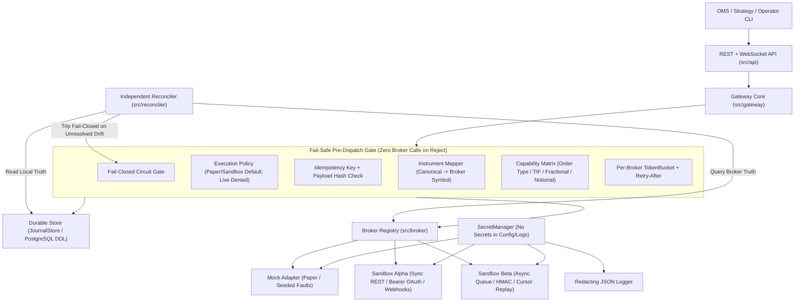
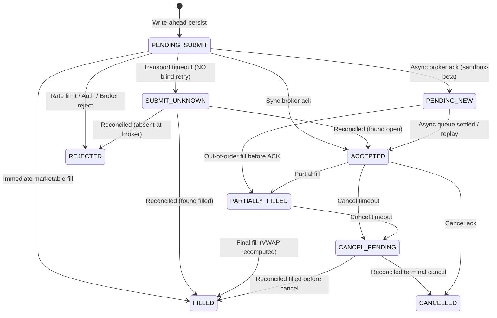

# Multi-Broker Trading Gateway — Architecture

## Overview

The Multi-Broker Trading Gateway (MBTG) provides a unified, fail-closed execution boundary between upstream OMS/strategy systems and heterogeneous broker venues. It isolates external broker contracts behind a single `broker.Adapter` interface, enforces versioned capability and instrument validation prior to dispatch, guarantees idempotent order/fill normalization, and runs an independent reconciliation engine that halts execution on unresolved state drift.

## Component Boundaries

| Component | Package | Responsibility |
|---|---|---|
| Domain Contract & Mapping | `src/domain` | Canonical `Order`, `Fill`, `OrderRequest`, `WebhookEvent`, structured `GatewayError`, versioned `CapabilityMatrix`, bidirectional `InstrumentMapper`, monotonic status ranks & VWAP recomputation. |
| Security & Policy Gate | `src/security` | `SecretManager` interface + `MemorySecretManager`, `SecretString` (always prints/marshals `[REDACTED]`), `RedactingLogger` (scrubs secrets & patterns), deterministic `ExecutionPolicy` (paper/sandbox default; live explicitly denied). |
| Rate Limiting & Clocks | `src/ratelimit` | Per-broker `TokenBucket` enforcing local burst/rate caps and honoring upstream HTTP 429 `Retry-After` windows with injectable `Clock`. |
| Broker Adapter Contract | `src/broker` | Unified `Adapter` interface & concurrency-safe `Registry`. |
| Broker Adapters | `src/adapters/{mock,sandbox_alpha,sandbox_beta}` | Deterministic mock + two distinct sandbox adapters (sync REST/OAuth vs async queue/HMAC/cursor-replay). |
| Persistence & Recovery | `src/storage` | `Store` interface, `MemoryStore`, durable append-only JSONL `JournalStore` with startup replay, plus PostgreSQL DDL (`docs/schema.sql`). |
| Gateway Core | `src/gateway` | Orchestrates fail-closed gate, policy, symbol mapping, capability checks, idempotency, adapter dispatch, webhook deduplication, out-of-order fill handling, cursor replay, and operational metrics. |
| Independent Reconciler | `src/reconciler` | Audits broker ground truth against local store, resolves `SUBMIT_UNKNOWN` and `CANCEL_PENDING` without blind retries, detects phantom/missing orders & quantity drift, and trips fail-closed halt. |
| REST & WebSocket API | `src/api` | Pure Go stdlib HTTP REST endpoints and RFC 6455 WebSocket live event stream (`/v1/ws`). |

## Architecture Diagram

## Order Lifecycle & Unknown-Outcome Resolution

