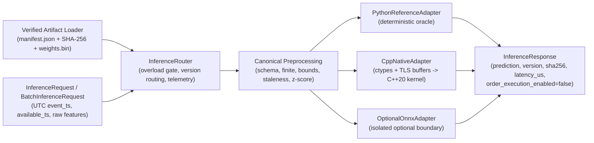

# Architecture & Component Boundaries

## System Overview

## Component Responsibilities

| Component | Module(s) | Responsibility & Boundary |
|---|---|---|
| Domain contracts & errors | `src/inference_engine/contracts.py` | Immutable dataclasses (`ModelManifest`, `FeatureSpec`, `LayerSpec`, `StalenessPolicy`, `InferenceRequest`, `InferenceResponse`), strict UTC parsing, structured `ErrorCode` / `EngineError`. |
| Artifact store & integrity | `src/inference_engine/artifact.py` | Safe IEEE-754 bundle writer/loader, SHA-256 verification of `weights.bin` and `reference_golden.json`, path-traversal prevention, explicit rejection of untrusted serialized formats (`.pkl`, `.joblib`, `.pt`, etc.). |
| Canonical preprocessing | `src/inference_engine/preprocessing.py` | Point-in-time timestamp checks (`event_ts_utc <= available_ts_utc <= inference_ts_utc + skew`, `age <= max_feature_age_ms`), missing/non-finite/bounds validation, z-score standardization + symmetric clipping. |
| Python reference scorer | `src/inference_engine/reference_scorer.py` | Ground-truth deterministic pure-Python MLP scorer and chronological synthetic LOB dataset/model exporter (`v1.0.0`, `v2.0.0`). |
| Native C++20 kernel & adapters | `src/native/inference_kernel.{hpp,cpp}`, `src/inference_engine/runtime_adapter.py` | Zero-heap-allocation stack-buffered C++20 scorer implementing identical preprocessing + dense layers, `CppNativeAdapter` with thread-local reusable ctypes buffers, and isolated `OptionalOnnxAdapter`. |
| Versioned router & operational controls | `src/inference_engine/router.py` | Primary / deterministic-hash canary / pinned version routing, atomic staging + parity verification on reload, rollback stack, non-blocking `max_in_flight` overload shedding, execution-disabled guard, health & metrics snapshots. |
| Load & latency harness | `src/inference_engine/benchmark.py`, `src/native/bench_native.cpp` | Cold start, warm single, warm batch, concurrent throughput/latency, allocation optimization comparison, pure C++20 native microbenchmark, and p99 tail regression gates. |

## API / Schema Contract Summary

### Request (`InferenceRequest`)
- `request_id`: stable caller identifier (also used as deterministic hash key for canary routing).
- `instrument_id`: instrument identifier (e.g. `SYN-EQUITY-A`).
- `currency`: explicit ISO currency (e.g. `USD`).
- `event_ts_utc`: ISO-8601 UTC timestamp with explicit offset (`Z` or `+00:00`) when the market event occurred.
- `available_ts_utc`: ISO-8601 UTC timestamp when features became available (must satisfy `event_ts_utc <= available_ts_utc <= inference_ts_utc + max_clock_skew_ms`).
- `features`: mapping of feature name to finite `float64` value matching `ModelManifest.features`.
- `model_version` (optional): explicit version pin; omitted uses active routing policy.

### Response (`InferenceResponse`)
- Includes `model_id`, `model_version`, `artifact_sha256`, `runtime_name`, `route_tag` (`primary` | `canary` | `pinned`), `output_name`, `output_unit`, `prediction`, `inference_ts_utc`, `feature_age_ms`, `latency_us`, and `order_execution_enabled` (always `false` unless explicitly authorized).

### Structured Errors (`ErrorCode`)
All invalid inputs, stale/future timestamps, tampered or untrusted artifacts, version misses, and overload conditions raise `EngineError` with machine-readable `error_code` and `details`, never silently emitting a fallback number.
